# 🔎 Benchmark de referencias

Sitios que estamos usando como referencia visual, de interacción y de tono para el demo. Cada tarjeta dice **qué tomar específicamente** — no se trata de copiar.

Las capturas viven en [`../contexto/referencias/`](../contexto/referencias/).

---

## 1. Time Out Top Eats × Pepsi
🔗 https://pepsi.timeout.com/
🎯 **Qué tomar:** mapa 3D con curvatura de globo terráqueo (no plano). Lista lateral grande, filtros píldora con ícono, avatares flotando.

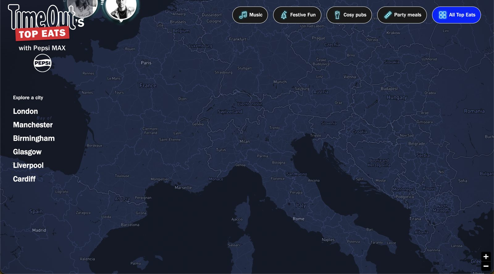

**Para Bimbo:** presencia global (países, plantas, marcas por región) y navegación por región del explorador de marcas.
**Adaptación:** el original es oscuro — para Bimbo, mapa en crema o azul muy claro.
**Técnica probable:** Mapbox GL / MapLibre / globe.gl / Three.js.

---

## 2. Akaru
🔗 https://www.akaru.fr/
🎯 **Qué tomar:** fluidez y estilo de la transición entre cards. Paneles verticales de color sólido tipo acordeón horizontal continuo.

| | |
|---|---|
| 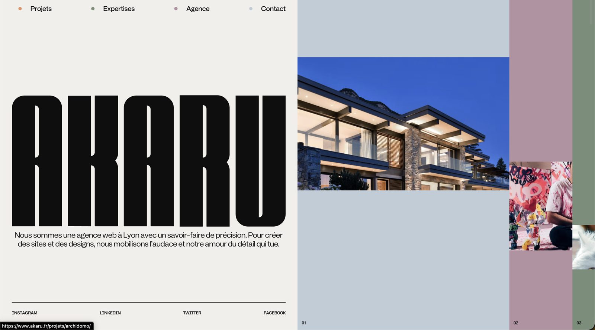 | 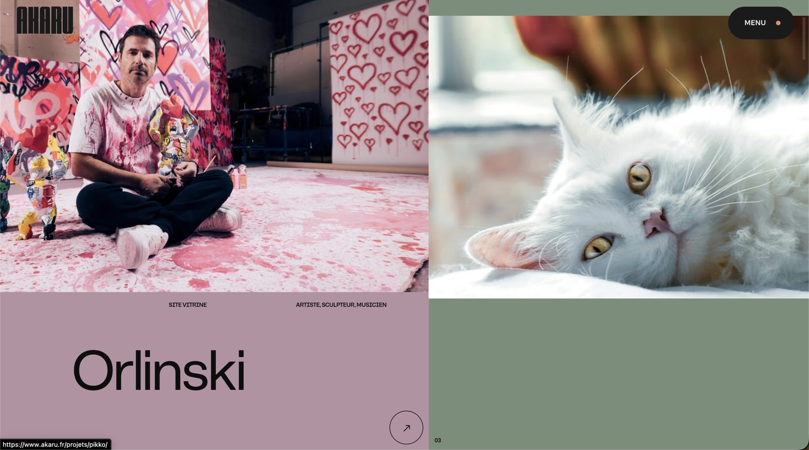 |

**Para Bimbo:** explorador de marcas (cada marca, un panel con su color) o "Un día en México" (un panel por momento).
**Adaptación:** colores de marca más vivos y cálidos sobre base crema.
**Técnica probable:** GSAP ScrollTrigger + Lenis, animando ancho del panel y clip-path/escala de la imagen.

---

## 3. Le Pain Quotidien
🔗 https://www.lepainquotidien.com/be/en
🎯 **Qué tomar:** hero con **tres capas** — foto de textura al fondo, titular en medio, pan recortado al frente que tapa parte del texto. Las palabras se revelan por scroll con blur → nítido.

| | |
|---|---|
| 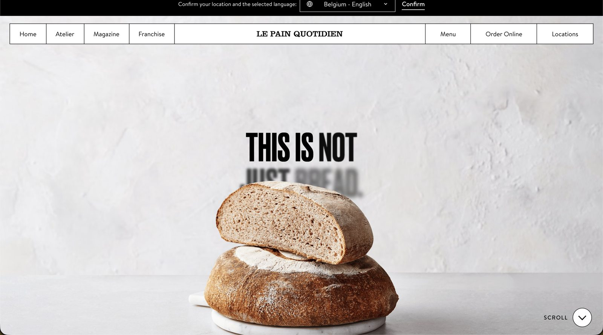 | 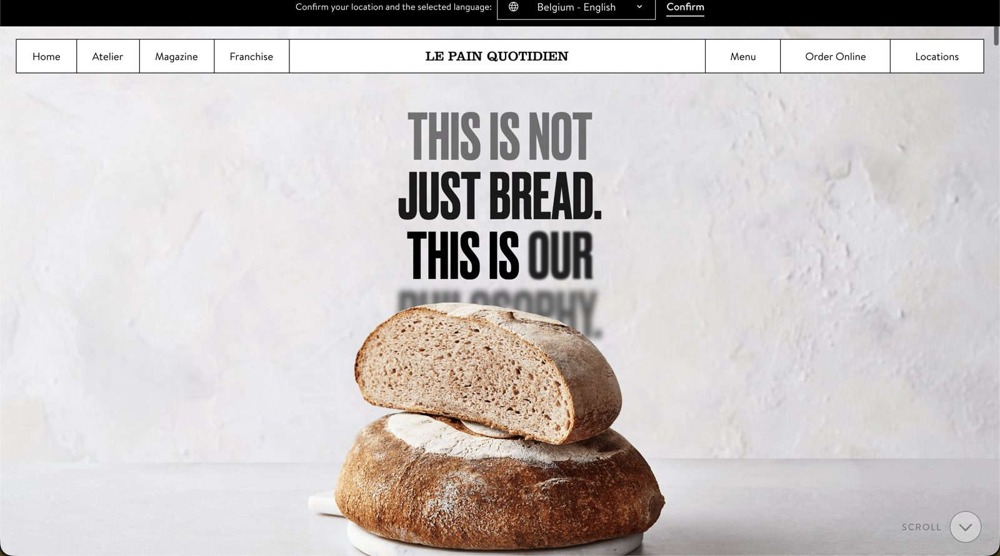 |

**Para Bimbo:** hero de la página con un producto icónico al frente y un mensaje atrás. El producto podría cambiar en cada frase.
**Adaptación:** fondo más cálido, tipografía igual de pesada pero más amable, toque de azul en la palabra activa.
**Requiere:** fotos de producto recortadas de buena calidad.

---

## 4. Barcoop Bevy
🔗 https://www.barcoopbevy.com/
🎯 **Qué tomar:** el fondo **no cambia de golpe entre secciones: se interpola** con el scroll, como una sola superficie que cambia de luz.

| | |
|---|---|
| 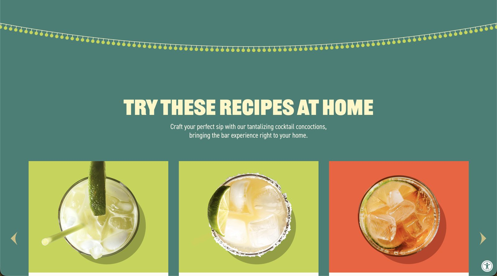 | 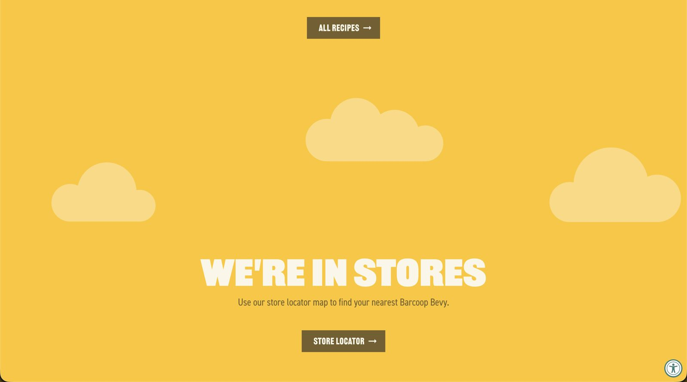 |

**Para Bimbo:** "Un día en México" (el color sigue la hora del día) y explorador de marcas (el fondo toma un tinte de la marca activa).
**Adaptación:** versiones suaves o pastel para mantener la base light; saturación completa solo en acentos.
**Técnica:** fondo fijo con color interpolado (ScrollTrigger o IntersectionObserver), en **OKLCH** para que los tonos intermedios no se vean grisáceos.

---

## 5. Polpharma Biologics
🔗 https://www.polpharmabiologics.com/
🎯 **Qué tomar:** pulcritud (mucho espacio, una idea por sección), datos elegantes (etiqueta pequeña gris, cifra grande, líneas finas), navegación en píldoras con conector curvo, serif editorial para los párrafos de mensaje.

| | |
|---|---|
| 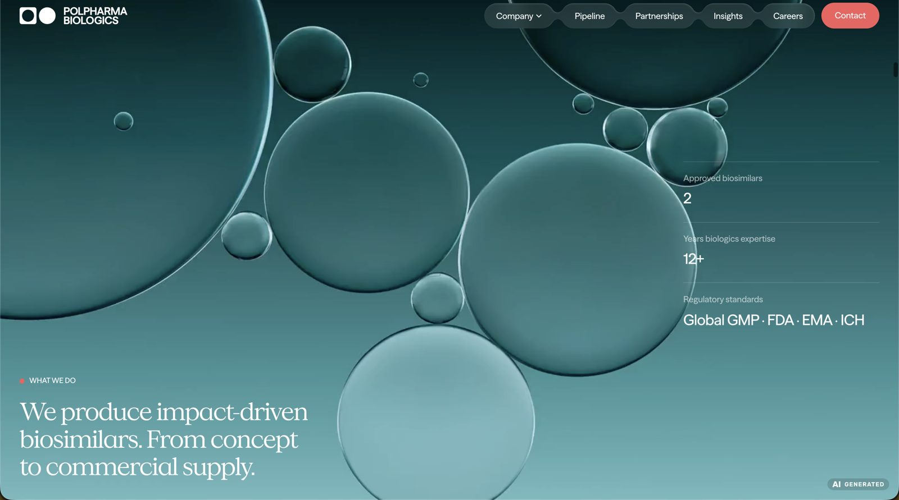 | 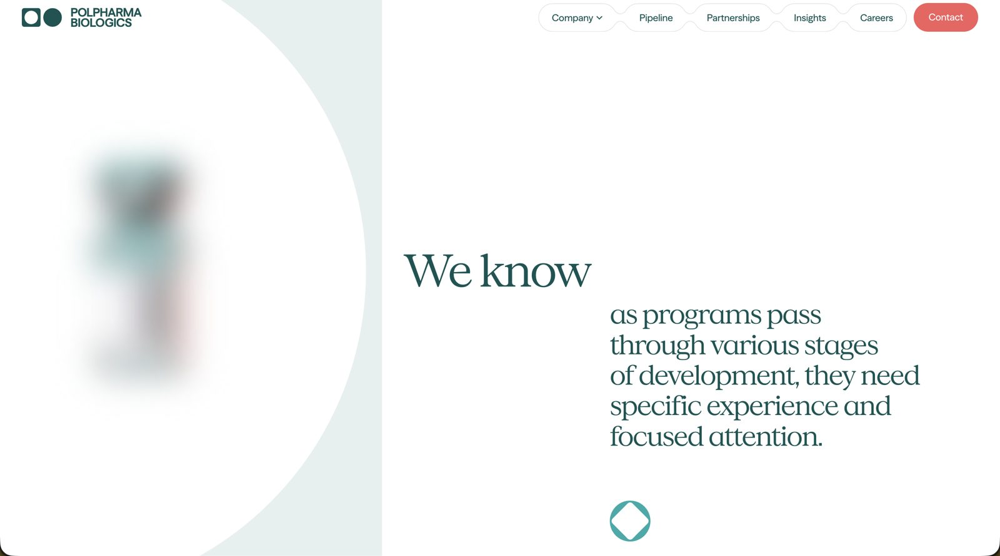 |

**Para Bimbo:** referencia del lado empresarial — cifras, historia, sustentabilidad, inversionistas.
**Adaptación:** el original es frío y técnico (farmacéutica). Llevar el mismo orden a la paleta cálida.
**Plataforma:** Webflow; hero probablemente con Unicorn Studio.

---

## 6. FIX Dessert Chocolatier
🔗 https://www.fixchocolatier.com/
🎯 **Qué tomar:** empaques como modelos 3D reales (volumen, brillo, sombras) en un **carrusel curvo en perspectiva**. Activo al centro, los demás girados hacia los lados con profundidad de campo (desenfocados). Debajo, cinta con nombres sincronizada.

| | |
|---|---|
| 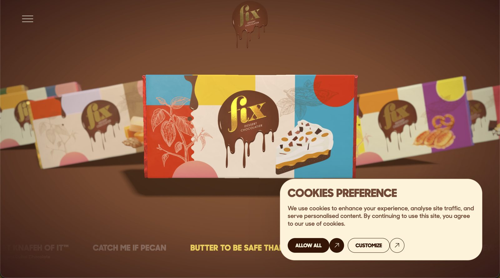 | 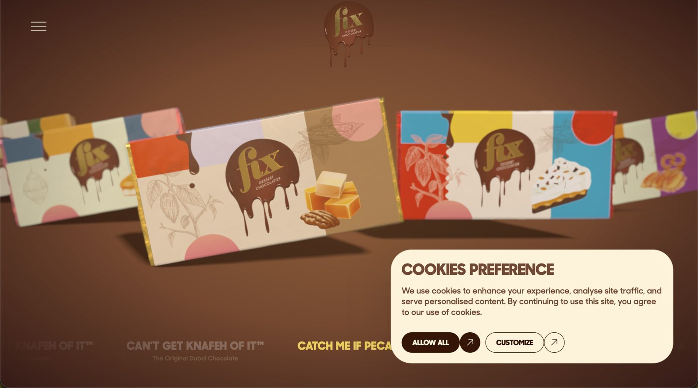 |

**Para Bimbo:** productos icónicos o fichas de marca (Pan Blanco, Gansito, Takis, Mantecadas). Combina con fondo que toma el color del producto activo.
**Adaptación:** fondo claro con tinte del producto, no chocolate oscuro.
**Requiere:** modelos 3D de empaques (GLB/GLTF). Para el demo bastan 3–5 sencillos.
**Técnica:** Three.js o React Three Fiber con postprocesado. En móvil, versión ligera o secuencia prerenderizada.

---

## ★ 7. Henrietta Said — referencia principal
🔗 https://henrietta.wearetattoodigital.com/
🎯 **Qué tomar:** es **la más cercana al tono global del sitio**.
- **Juguetón y amistoso con orden:** etiquetas tipo cinta inclinadas, ilustraciones con contorno blanco, badge circular "VIEW PRODUCT" en curva, franja vertical de colores de marca.
- **Tipografía en mayúsculas bold:** titulares condensados y pesados, texto corrido en mayúsculas condensadas ligeras.
- **Palabra gigante del sabor detrás del producto** ("BUFFALO", "PEPPER", "KIMCHI") en tono pálido del color de la sección, empaque al frente, descripción abajo.
- **Cintilla lateral de atributos:** reverso del empaque fijo al centro; paneles verticales de color se apilan desde la derecha, cada uno con un atributo e ilustración.

**Palabra gigante + producto:**

| 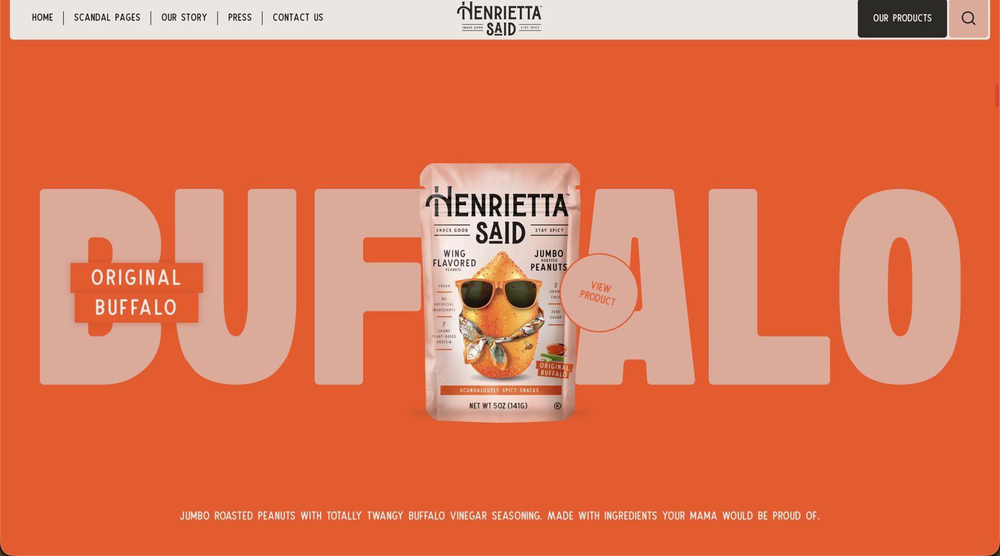 | 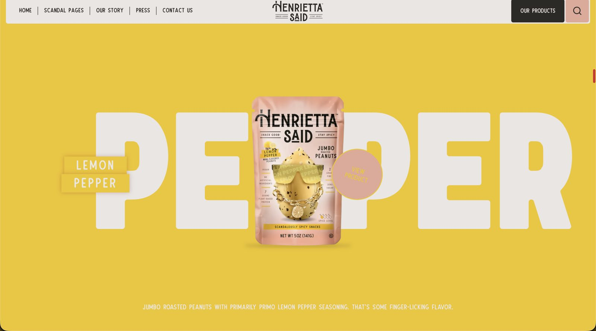 | 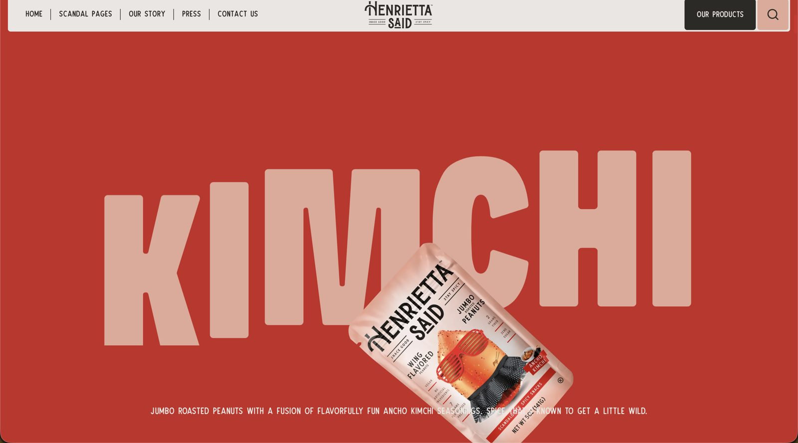 |
|---|---|---|

**Cintilla de atributos:**

| 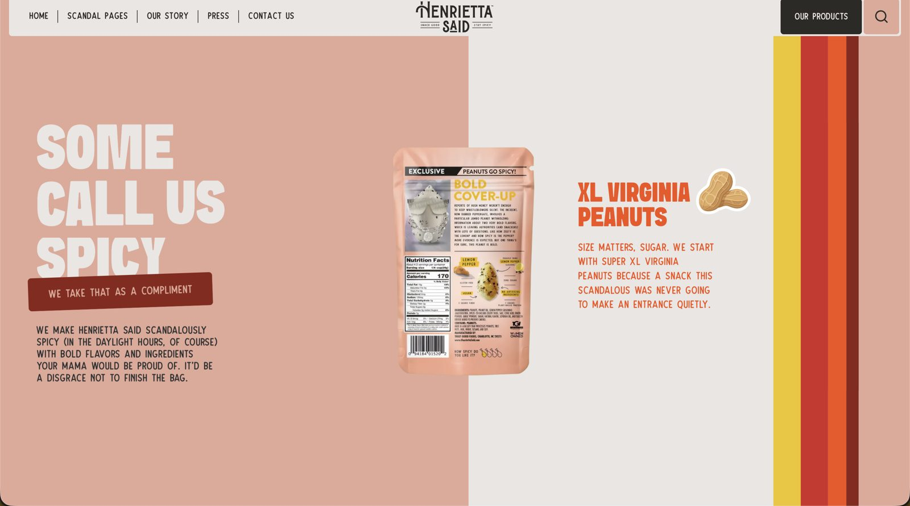 | 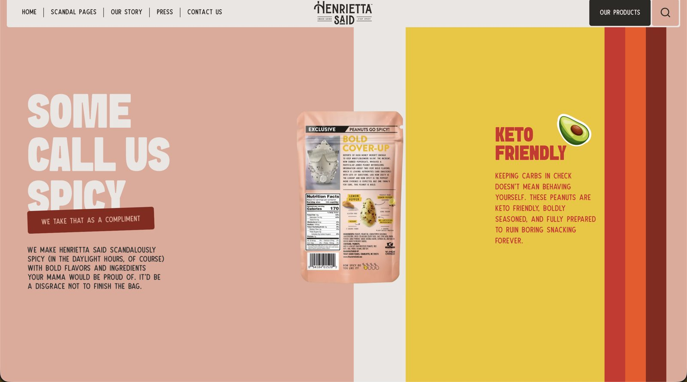 |
|---|---|

**Para Bimbo:** aplicarlo en productos icónicos y fichas de marca ("GANSITO" gigante detrás del empaque). La cintilla puede contar atributos de marca o la historia ("De 10 camiones a…").
**Adaptación — bajar el volumen:** menos stickers por pantalla, copy cálido en vez de pícaro, etiquetas menos inclinadas. La cintilla quizá es demasiado juguetona para la corporativa, pero funciona en fichas de producto.
**Técnica probable:** scroll pinneado (GSAP ScrollTrigger), sin 3D.

---

## 8. De Foodtruck Club
🔗 https://defoodtruckclub.nl/
🎯 **Qué tomar:** refuerza el estilo de Henrietta. Copy cercano y directo con un eslogan corto que se repite, stickers ilustrados, bloques que cuentan sin aburrir (cifras grandes, proceso en pasos, tira de logos).

**Idea para Bimbo:** saludos en varios idiomas en el hero ("¡buen provecho!", "Buon appetito"…). Un "¡Buen provecho!" rotando en los idiomas de los países donde opera Bimbo une lo amistoso con la escala global.

*No hay captura todavía — revisar en vivo.*

---

## 9. Duckbill Cookies
🔗 https://www.duckbillcookies.com.br/
🎯 **Qué tomar:** la **mascota como personaje** en varios puntos del sitio (ilustrada, en un peluche, en el footer con una galleta) — es el modelo para el osito Bimbo. Copy cálido, elementos del producto como recurso gráfico (granos de café como separadores y patrones), mapa de presencia con localizador.

**Para Bimbo:** es el caso más parecido en giro (galletas, consumo masivo, franquicias) y la referencia directa para cómo dosificar al osito.

*No hay captura todavía — revisar en vivo.*

---

## 📍 Mapa rápido: referencia → sección del demo

| Sección | Referencias que aplican |
|---|---|
| **Hero** | Le Pain Quotidien (capas + revelado), Henrietta (palabra gigante), Foodtruck Club (saludos multilingües) |
| **Un día en México** | Barcoop (fondo por momento), Akaru (paneles), osito como guía |
| **Explora nuestras marcas** | Akaru (transición de cards), Time Out (filtros en píldora), Barcoop (tinte de marca) |
| **Íconos / productos** | FIX (3D), Henrietta (palabra gigante + cintilla de atributos) |
| **De 10 camiones a…** | Polpharma (datos elegantes) |
| **Presencia global** | Time Out (mapa-globo), Duckbill (localizador) |
| **Sistema general** | Henrietta (tono), Polpharma (orden y tipografía), Duckbill (mascota) |

---

## 🧰 Técnicas transversales que aparecen

- **Scroll-driven animation:** GSAP + ScrollTrigger + Lenis es la combinación común (Henrietta, Akaru, Le Pain, Polpharma).
- **Interpolación de color:** OKLCH para que los pasos intermedios no griseen (Barcoop).
- **3D de producto:** Three.js / React Three Fiber con postprocesado (FIX).
- **Mapa-globo:** Mapbox GL / MapLibre / globe.gl (Time Out).
- **Mascota animada:** Lottie o Rive (Duckbill).
- **Blur → nítido** como lenguaje común de entrada (Le Pain, Polpharma).
- **Pinneado + palabra gigante** como patrón de sección-producto (Henrietta).
