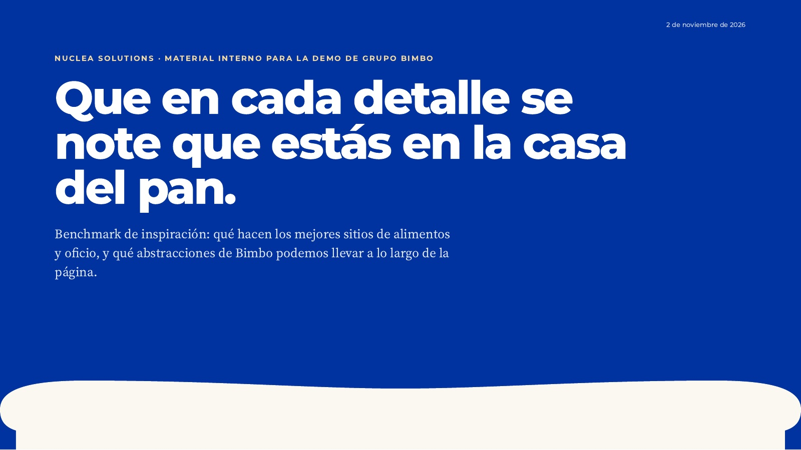

# 💡 Banco de ideas

Ideas de interacción y diseño para la demo que todavía no están en wireframes ni en código. Cada idea dice
de dónde salió, cómo se vería, qué necesita y qué falta decidir. Que una idea esté aquí no significa que vaya
en la demo: se aprueba antes de construirse.

---

## 01 · Del pan al osito: el corte del hero se vuelve el gorro del osito

**Estado:** idea registrada, sin aprobar · **Sección:** Inicio › hero · **Propuesta:** Marlon, 2 de noviembre de 2026

### De dónde sale
El benchmark de inspiración propone usar la **corona del pan de caja** como motivo protagonista: el corte entre
el azul y el fondo claro del hero tiene la silueta de una rebanada (hombros redondos, hondonada al centro).
Esa forma ya se alcanza a ver al pie de la lámina 1 del benchmark:

### La idea
Al hacer scroll, esa silueta de pan **se transforma en el gorro del Osito Bimbo**. Cuando el gorro ya es
reconocible, aparece debajo la cara del osito muy de cerca y la cámara hace **zoom out** hasta revelarlo
completo. El motivo abstracto (el pan) se convierte en el personaje de la marca: el visitante entiende de
golpe en qué casa está.

### Guion de scroll (sección pegajosa de ~300 vh)
| Avance | Qué se ve |
|---|---|
| 0 % | Hero actual: titular sobre azul y, al pie, el corte con la corona del pan. |
| 0–30 % | El titular sube y se desvanece; la corona se separa del borde y se centra. |
| 30–55 % | La corona se transforma (morph del trazo) en el gorro de panadero del osito; el relleno pasa de crema a blanco. |
| 55–75 % | Bajo el gorro entra la cara del osito en encuadre muy cerrado (solo ojos y hocico). |
| 75–100 % | Zoom out: se revela el osito completo y, a su lado, el siguiente mensaje de la home. |

### Cómo se haría
- Sección pegajosa con avance `p ∈ [0, 1]` calculado en el scroll (el mismo patrón del resto de la demo).
- Morph de la silueta del pan al gorro con dos trazos SVG del mismo número de puntos (GSAP MorphSVG o
  flubber); el zoom out con `transform: scale()` sobre un contenedor, sin re-pintar la ilustración.
- Ilustración del osito **en vector y oficial** (SVG o Lottie), nunca dibujada por nosotros.
- `prefers-reduced-motion`: se muestra directo el estado final (osito completo), sin morph ni zoom.
- Teléfono: misma secuencia, más corta (~200 vh) y con el osito encuadrado en vertical.
- Presupuesto: la animación no debe retrasar el contenido principal; el osito se carga después del primer
  pintado del hero.

### Qué falta decidir
- **Permiso de uso del Osito Bimbo** y el archivo oficial: es un activo de marca con reglas propias; hay que
  pedirlo al cliente. Sin ese archivo, la demo usa la secuencia hasta el gorro y marca el resto como
  `[ilustración oficial por confirmar]`.
- Si el osito vive solo en la home o reaparece (404, carga, cierre de Historia).
- Encaje con la guía del benchmark: ahí se pide no usar al osito *como adorno*. Aquí no es adorno sino el
  remate de la historia del motivo, y aparece una sola vez.

### Referencias
- Benchmark de inspiración: [`skills/benchmark-inspiracion`](../../skills/benchmark-inspiracion/SKILL.md) (método y ejemplo de Bimbo).
- Morph de forma y producto que se arma con el scroll: TÒPAS (https://bar-topas.ch/) y Morpho Water
  (https://morphowater.com/), según el benchmark de Awwwards del 2 de noviembre de 2026.

---

## 02 · El camión que cambia de época al avanzar

**Estado:** prototipo funcional, sin aprobar · **Sección:** Nosotros › historia · **Propuesta:** Marlon, 3 de noviembre de 2026

### La idea
Un camión de reparto avanza por una carretera conforme el usuario hace scroll. Cada época tiene un arco en el
camino con su década; mientras el camión lo cruza, la parte que ya pasó el arco es el camión de la época nueva
y la que no, el anterior. Recorre seis épocas: años 40, 70, 80, 90, 2025 y el tráiler de los 80 años.

### Cómo verla
Con `npm run dev`, abrir `/prototipos/camiones/index.html`. Es una página estática en
[`public/prototipos/camiones/`](../../public/prototipos/camiones/) con three.js 0.169 desde CDN; no toca las
páginas de Next.

### Cómo funciona
- Seis modelos GLB (1.7 MB en total) con la misma altura y la nariz en `x = 0`; las llantas giran con la distancia.
- El camión se queda en el origen y el mundo se mueve. Dos planos de recorte por modelo (`clippingPlanes`,
  `clipShadows`) muestran cada camión solo entre su arco de entrada y el de salida.
- [`scripts/camiones/exportar_glb.py`](../../scripts/camiones/exportar_glb.py) regenera un GLB desde Blender.

### Qué falta decidir
- **Material oficial de los camiones.** Los modelos son aproximaciones hechas a partir de fotos de juguetes de
  colección y sus calcas salen de esas fotos: van contra la regla de marca de `CLAUDE.md` (camiones que no se
  aproximan, fotos de terceros que no se publican). Se suben para evaluar la interacción; para producción se
  reemplazan por modelos o renders oficiales o se retiran.
- Si va en Nosotros (intensidad 5) y cómo se integra como componente de Next.
- Diseño del arco (hoy un marco blanco con la década) y versión con `prefers-reduced-motion`.
